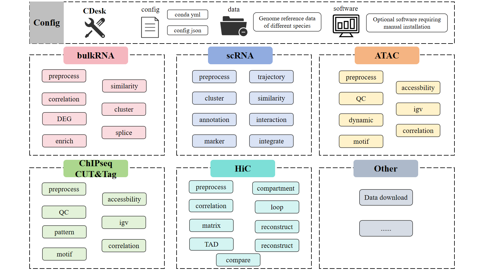

# CDesk Multi-Omics Analysis Pipeline

📚 **Documentation**: [**User Guide**](https://zsifu.github.io/CDesk.html)

CDesk is an integrated multi-omics analysis sand-box designed for processing data from various sequencing-based assays, including RNA-seq, scRNA-seq, ATAC-seq, CUT&Tag, ChIP-seq, and Hi-C. It comprises multiple modules that cover a comprehensive range of analysis tasks, from raw sequencing data process to downstream various advanced functions. Dedicated conda environment YAML files are supplied. To install, simply download the pre-built Docker image and prepare the necessary species-specific data. Once configured, users can perform the desired analyses by entering the corresponding command on the command line.

## Installation

### Download the Docker Image

CDesk and its required tools, Conda environments, R packages, and Python packages are bundled in the Docker image. Download and load the image to use CDesk; there is no need to clone the source code or install the analysis environments separately.

Download the image archive from **【待填写：最新镜像下载链接】**. The archive filename is **【待填写：镜像压缩包文件名】**.

### Load and Start the Image

#### Linux

Install Docker Engine, then load the downloaded archive:

~~~bash
docker load -i "【镜像压缩包的绝对路径】"
~~~

The load command prints the image name and tag. Use that value below. Create a working directory on the host for your input files, sample information tables, configuration, and results, then start the container:

~~~bash
docker run -it --name cdesk \
  -v "【宿主机工作目录的绝对路径】:/work" \
  -w /work \
  "【实际镜像名称:标签】" \
  /bin/bash
~~~

The host working directory is available as /work inside the container. Files written under /work are saved in the host directory. Use container-visible paths in commands and input tables, for example /work/data/sample_R1.fastq.gz. Keep the image's /CDesk directory intact; do not mount your working directory over it.

#### Windows

Install WSL 2 with a Linux distribution such as Ubuntu, and install Docker Desktop. In Docker Desktop, enable the WSL 2 engine and WSL integration for that distribution. Run the following commands in the **WSL terminal**, not Windows Command Prompt or PowerShell.

Load the downloaded image. A Windows path such as F:\CDesk\image.tar.gz is available in WSL as /mnt/f/CDesk/image.tar.gz:

~~~bash
docker load -i "【WSL 中镜像压缩包的绝对路径】"
~~~

Start the container with a working directory mounted at /work:

~~~bash
docker run -it --name cdesk \
  -v "【WSL 中工作目录的绝对路径，例如 /mnt/f/git/CDesk】:/work" \
  -w /work \
  "【实际镜像名称:标签】" \
  /bin/bash
~~~

For example, a file at F:\git\CDesk\my_config.json on Windows is /mnt/f/git/CDesk/my_config.json in WSL and /work/my_config.json inside this container.

After exiting the container, Linux and Windows/WSL users can return to the same container with:

~~~bash
docker start -ai cdesk
~~~

### After Installation, You Should Be Able to Run CDesk Now

Inside the container, run:

~~~bash
CDesk -h
~~~

If the CDesk help is displayed, the installation is successful. The available modules include:

~~~text
CDesk multiomics pipeline

{tools,bulkRNA,scRNA,ATAC,ChIPseqCUTTag,HiC}
  tools           Some other tools
  bulkRNA         bulkRNA-seq pipeline
  scRNA           scRNA pipeline
  ATAC            ATAC pipeline
  ChIPseqCUTTag    ChIPseq&CUTTag pipeline
  HiC             HiC pipeline
~~~

### Prepare the Data and Write the Configuration File

You need to prepare reference data for the species of interest and specify the corresponding file paths in the config.json configuration file. This file stores paths to genomic data, annotation files, and additional software installations.

The example below is from the current branch's config.json. **【待核对并替换：最新镜像内的实际 config.json；本示例尚未完成镜像内核对】**. You can customize it to support additional species or data types. The reference data and tools needed depend on the task you intend to run.

An example of the configuration file

~~~json
{
  "software": {
    "cellranger": "/root/cellranger-10.0.0/bin/cellranger",
    "DrSeq": "/root/Dr.seq.1.2.0/bin/Drseq.py",
    "dnbc4tools": "/root/dnbc4tools3.1/dnbc4tools",
    "juicer_tools_jar": "/root/juicer_tools_1.22.01.jar",
    "celescope_path": "/opt/conda/envs/celescope/bin"
  },
  "conda_env": {
    "CDesk": "/opt/conda/envs/CDesk",
    "CDesk_R": "/opt/conda/envs/CDesk_R",
    "CDesk_py3.7": "/opt/conda/envs/CDesk_py3.7",
    "CDesk_py2.7": "/opt/conda/envs/CDesk_py2.7"
  },
  "data": {
    "TAIR10": {
      "hisat2_index": "/CDesk/TAIR/hisat2_index/TAIR10",
      "refseq_gtf": "/CDesk/TAIR/Araport11.gtf",
      "refseq_bed": "/CDesk/TAIR/Araport11.bed",
      "chromInfo": "/CDesk/TAIR/TAIR10.chrom.sizes",
      "fasta": "/CDesk/TAIR/TAIR10.fasta",
      "tf_file": "/CDesk/TAIR/Ath_TF_list.txt",
      "promoter_file": "/CDesk/TAIR/TAIR10_promoter_transcipt_updown_2kb_promoter.bed",
      "TE_idx": "/CDesk/TAIR/TAIR10.exclusive.idx",
      "scRef10x": "/CDesk/TAIR/scRef10x/TAIR",
      "effective_genome_size": "1.19e8",
      "gff3": "/CDesk/TAIR/Araport11.gff",
      "refgenes": "/CDesk/TAIR/TAIR.refgenes.txt",
      "bowtie2_mapindex": "/CDesk/TAIR/bowtie2_index/TAIR10",
      "singleron_mapindex": "/CDesk/TAIR/singleron_mapindex",
      "dnbc_mapindex": "/CDesk/TAIR/dnbcIndex/TAIR"
    }
  }
}

~~~

- **software**: Paths to tools installed in the image. Keep the entries required by your workflows.
- **conda_env**: Paths to the CDesk environments inside the image.
- **data**: Reference data configurations for different species. The TAIR10 key corresponds to --species TAIR10.

The reference data fields are described below.

| Field | Meaning and Purpose | What to Specify |
|---|---|---|
| `hisat2_index` | HISAT2 alignment index used by workflows such as bulk RNA-seq to align sequencing reads to the reference genome | The shared prefix of the index files, not a directory or a FASTA file |
| `refseq_gtf` | GTF gene annotation containing the coordinates of genes, transcripts, exons, and other features; used for RNA analysis and for locating genes in `accessbility --mode gene` | `.gtf` file |
| `refseq_bed` | BED annotation of transcript structures, read as an RSeQC annotation during bulk RNA preprocessing for read distribution quality control | An annotation BED file that meets the tool's requirements, typically BED12; an arbitrary three-column peak BED file cannot be used as a substitute |
| `chromInfo` | Chromosome size table containing chromosome names and lengths; used for signal statistics, BigWig conversion, and related tasks | A text file, typically with two columns |
| `fasta` | Reference genome sequences containing the DNA nucleotide sequences of chromosomes | `.fa`, `.fasta`, or `.fna` file |
| `tf_file` | Table of transcription factor genes, used by ATAC dynamic analysis to identify transcription factors among associated genes | The current code reads a tab-delimited table and requires a column named `Symbol` |
| `promoter_file` | Table of promoter regions, used to calculate promoter signals and associate ATAC regions with genes | The relevant current code requires at least five columns: chromosome, start, end, transcript, and gene |
| `TE_idx` | Index for transposable element analysis; the bulk RNA TE analysis workflow passes it to `scTE -x` | An index file recognized by scTE, not a HISAT2 or Bowtie2 index |
| `scRef10x` | Cell Ranger reference database used for preprocessing 10x single-cell RNA-seq data | A prebuilt Cell Ranger reference directory, not a single FASTA file |
| `effective_genome_size` | Effective genome size used in MACS peak-calling calculations for ATAC/ChIPseqCUTTag | A numeric value or another value supported by the tool, not a file path |
| `gff3` | GFF3 gene annotation read by the current alternative splicing visualization script | `.gff3` file; changing a GTF file's extension does not convert it to GFF3 |
| `refgenes` | Reference gene annotation used by DrSeq; the source code passes it to DrSeq's `-g` argument | A reference annotation file that meets DrSeq's requirements, not a simple single-column list of gene names |
| `bowtie2_mapindex` | Bowtie2 alignment index used by workflows such as ATAC, ChIPseqCUTTag, and DrSeq | The shared prefix of the index files |
| `singleron_mapindex` | Singleron/CeleScope reference database; the source code passes it to `--genomeDir` | A reference directory prepared for the corresponding tool |
| `dnbc_mapindex` | DNBelab C Series/dnbc4tools reference database; the source code passes it to `--genomeDir` | A reference directory prepared for the corresponding tool |

Use consistent chromosome names and a matching genome assembly across reference sequences, annotations, indices, and analysis inputs.

#### Use a Configuration File Stored Outside the Image

You can create and edit my_config.json in the host working directory without modifying the image. Copy the complete configuration example above, retain the software and conda_env paths for the image you are using, and edit the reference data entries as needed.

With the /work mount shown above, the host configuration file is available inside the container as **/work/my_config.json**. CDesk uses its bundled config.json by default; select your external file explicitly with **--config before the module name**:

~~~bash
CDesk \
  --config /work/my_config.json \
  ATAC preprocess \
  --input /work/samples.csv \
  --output /work/result \
  --species TAIR10
~~~

For the Windows example, the host file F:\git\CDesk\my_config.json is used through its mounted container path /work/my_config.json, not through the Windows path.

All file paths in my_config.json must be accessible **inside the container**. For reference data stored outside the mounted working directory, add a separate mount when creating the container, for example:

~~~bash
docker run -it --name cdesk_external_ref \
  -v "【宿主机工作目录的绝对路径；Windows 使用 WSL 路径】:/work" \
  -v "【宿主机参考数据目录的绝对路径；Windows 使用 WSL 路径】:/reference:ro" \
  -w /work \
  "【实际镜像名称:标签】" \
  /bin/bash
~~~

Use /reference/... paths for those reference resources in my_config.json. The example command above still selects the configuration with --config /work/my_config.json.
